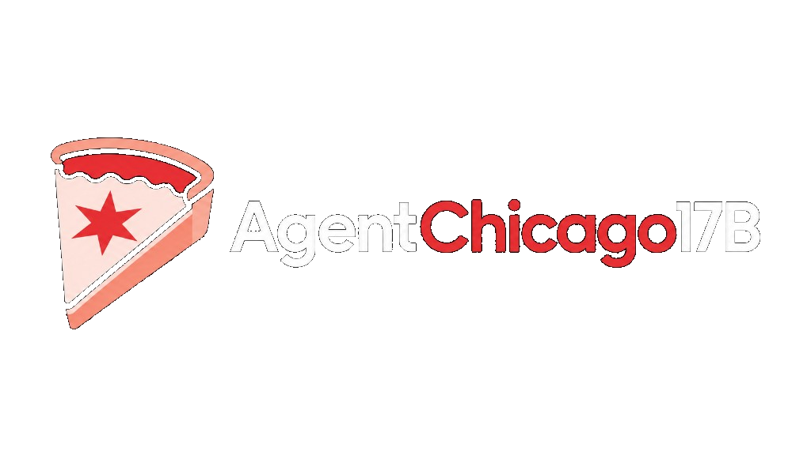
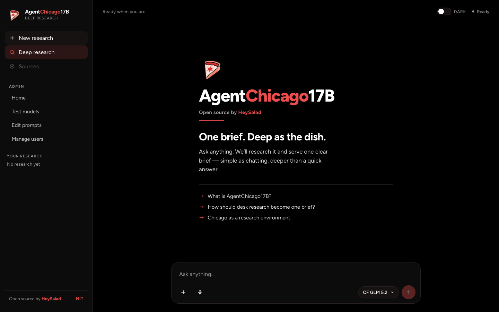
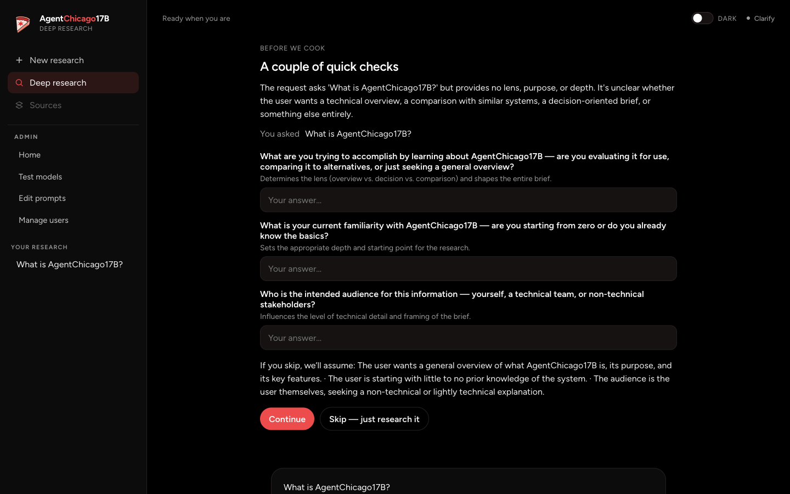
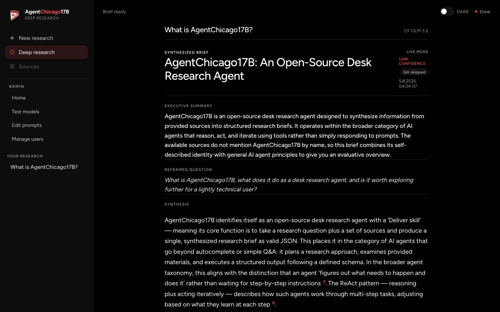
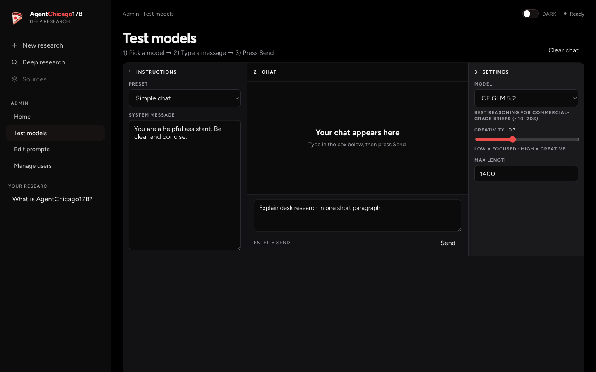

# AgentChicago17B

<p align="center">
  
</p>

<p align="center">
  
</p>

<p align="center">
  <strong>Open-source desk research agent by <a href="https://github.com/Hey-Salad">HeySalad</a></strong><br />
  Ask a question → cook a structured research pass → get <strong>one synthesized brief</strong>.
</p>

<p align="center">
  <em>One brief. Deep as the dish.</em>
</p>

<p align="center">
  
  
  
</p>

---

## Screenshots

### Home — brand desk



### Clarify — before we cook



### Brief — one synthesized answer



### Admin — test models



---

## How it works

```
ask → clarify (optional) → discover → define → develop → gather → extract → deliver → critique → one brief
```

| Step | What you see |
|------|----------------|
| **Ask** | Type or speak a question in the composer |
| **Clarify** | A couple of quick checks so the brief hits the right lens |
| **Cook** | Staged research (scope, plan, gather, extract, synthesize) |
| **Deliver** | One editorial brief — summary, findings, gaps, next steps |
| **Cite** | Chicago 17th notes-bibliography style (`[1]` → bibliography) |
| **QA** | A critique pass can rewrite once if the brief needs work |

Demo mode works with **no API keys**. Live mode uses Cloudflare Workers AI and/or NVIDIA via a local Vite proxy (`/api/llm/chat`), with optional Tavily for web sources.

Brand kit lives in `public/brand/` (deep-dish mark + Chicago six-point star, HeySalad cherry `#ed4c4c`, Figtree).

---

## Table of contents

1. [Screenshots](#screenshots)
2. [How it works](#how-it-works)
3. [What you get](#what-you-get)
4. [Quick start (local)](#quick-start-local)
5. [Modes: demo vs live](#modes-demo-vs-live)
6. [Environment variables](#environment-variables)
7. [Using the app](#using-the-app)
8. [Project layout](#project-layout)
9. [Hosting how-tos](#hosting-how-tos)
10. [Security notes](#security-notes)
11. [Roadmap](#roadmap)
12. [Where to publish this repo](#where-to-publish-this-repo)
13. [Contributing](#contributing)
14. [Scripts](#scripts)
15. [License](#license)

---

## What you get

| Piece | Description |
|--------|-------------|
| Research pipeline | Clarify → cook stages → deliver → optional critique rewrite |
| Output | One brief: summary, reframed question, narrative, findings, gaps, next steps, confidence |
| Citations | Chicago 17th notes-bibliography |
| Voice input | Mic → Cloudflare Whisper transcription (live) |
| Demo mode | Works with **no API keys** |
| Live mode | Cloudflare Workers AI and/or NVIDIA Build (+ optional Tavily) |
| Admin | Test models, edit prompts, manage users (local studio) |
| UI | HeySalad Chicago research desk — mark, wordmark, cherry accent |

---

## Quick start (local)

Requires **Node.js 20+** (18+ may work; 20 recommended).

```bash
git clone https://github.com/Hey-Salad/AgentChicago17B.git
cd AgentChicago17B
npm install
npm run dev
```

Open the URL Vite prints (default: [http://127.0.0.1:5173](http://127.0.0.1:5173)).

You can demo immediately with no keys — try a starter prompt on the empty state.

For **live** synthesis:

```bash
cp .env.example .env
# edit .env with Cloudflare and/or NVIDIA keys
npm run dev
```

Restart `npm run dev` after any `.env` change.

---

## Modes: demo vs live

| Mode | When | What happens |
|------|------|----------------|
| **Demo** | No usable LLM config, or live call fails | Curated / fallback brief so the UI always has something to show |
| **Live** | LLM configured via Vite proxy | Model returns JSON for one brief; optional Tavily adds real web sources |

Important architecture detail for hosting:

- The browser talks to **`POST /api/llm/chat`**
- In local dev, that route is served by a **Vite middleware proxy** (`vite.config.ts`) so API keys stay off the client and CORS is avoided
- A static SPA upload alone does **not** include that proxy — demos still work; live mode needs the same endpoint on your host (Worker / Function / Cloud Function / etc.)

```
Browser UI  →  /api/llm/chat (your server)  →  Cloudflare Workers AI or NVIDIA
            →  /api/stt/transcribe (Whisper, optional)
            →  Tavily (optional, for sources)
```

---

## Environment variables

Copy `.env.example` → `.env` (never commit `.env`).

| Variable | Required for | Purpose |
|----------|--------------|---------|
| `VITE_CF_API_KEY` | Cloudflare live models + Whisper | Workers AI API token |
| `VITE_CF_BASE_URL` | Cloudflare live models | `https://api.cloudflare.com/client/v4/accounts/<ACCOUNT_ID>/ai/v1` |
| `VITE_LLM_MODEL` | Default model picker | e.g. `@cf/zai-org/glm-5.2` |
| `VITE_LLM_API_KEY` | NVIDIA live models | NVIDIA Build API key |
| `VITE_LLM_BASE_URL` | NVIDIA live models | Usually `https://integrate.api.nvidia.com/v1` |
| `VITE_TAVILY_API_KEY` | Live web sources | Optional; without it, live mode synthesizes from model knowledge |

**Cloudflare setup**

1. Cloudflare dashboard → Workers AI / API tokens with Workers AI permissions  
2. Set `VITE_CF_API_KEY` and `VITE_CF_BASE_URL` with your account id  
3. Prefer `@cf/...` models in the UI dropdown  

**NVIDIA setup**

1. Sign in at [build.nvidia.com](https://build.nvidia.com/)  
2. Create a key at [API keys](https://build.nvidia.com/settings/api-keys)  
3. Set `VITE_LLM_API_KEY` + `VITE_LLM_BASE_URL`  

**Tavily (optional)**

1. Get a key from [tavily.com](https://tavily.com/)  
2. Set `VITE_TAVILY_API_KEY`  

> Note: variables prefixed with `VITE_` are visible to the Vite client build unless only the **server proxy** reads them. Today the proxy loads env on the Vite server. For production hosts, store secrets in the platform secret store and **do not** bake provider keys into the frontend bundle.

---

## Using the app

1. Open the empty state — pizza mark, **AgentChicago17B**, “Open source by HeySalad”
2. Pick a starter or type / speak a research question
3. Answer clarify checks (or skip) so the brief has the right lens
4. Choose a model (default: **CF GLM 5.2**)
5. Watch the cook stages, then read the **synthesized brief** + bibliography
6. Use **New research** or the sidebar history for another question
7. Optional: Admin → **Test models** / **Edit prompts** for power users

Suggested demo questions:

- What is AgentChicago17B?
- How should desk research become one brief?
- Chicago as a research environment

---

## Project layout

```
AgentChicago17B/
├── src/
│   ├── App.tsx                 # Shell: sidebar, empty state, composer, results
│   ├── App.css / index.css     # Brand tokens + layout
│   ├── agent/                  # Pipeline, intent, critique, Chicago cites, models
│   ├── admin/                  # Skills store + dashboard pages
│   ├── components/             # Brief, sources, cooking status, admin UI
│   └── hooks/                  # Voice input, etc.
├── public/brand/               # Official mark + lockup assets
├── docs/images/                # README screenshots + brand copies
├── vite.config.ts              # Dev server + /api/llm/chat (+ STT) proxy
├── .env.example
└── README.md
```

---

## Hosting how-tos

Legend used below:

| Badge | Meaning |
|-------|---------|
| **Ready now** | Follow steps and it works with current code |
| **UI ready / proxy TBD** | You can ship the static UI today; live LLM needs a `/api/llm/chat` adapter on that platform (same contract as the Vite proxy) |
| **Planned** | Documented target; implementation landing as the open-source surface grows |

Every cloud path starts the same:

```bash
npm install
npm run build
# output: dist/
```

### 1. Local

**Status: Ready now**

Best path for contributors and demos.

```bash
npm install
cp .env.example .env   # optional for live mode
npm run dev            # http://127.0.0.1:5173
```

Production-like local check:

```bash
npm run build
npm run preview
```

> `vite preview` serves the static build. Live LLM still depends on the **dev** proxy unless you add a separate API process. For full live demos, use `npm run dev`.

---

### 2. Cloudflare

**Status: UI ready / proxy TBD** (Workers AI is already a first-class *model provider*; hosting the app on Cloudflare Pages/Workers is the next step)

#### A. Use Cloudflare as the LLM provider (works locally today)

Configure `.env` with `VITE_CF_*` as above and run locally. Models prefixed `@cf/` route through the Vite proxy to Workers AI.

#### B. Host the UI on Cloudflare Pages

1. Push this repo to GitHub  
2. Cloudflare dashboard → **Workers & Pages** → **Create** → Connect repo  
3. Build settings:
   - **Build command:** `npm run build`
   - **Build output directory:** `dist`
4. Deploy  

You get the branded UI + **demo mode**.

#### C. Live mode on Cloudflare (recommended production shape)

Add a **Pages Function** or **Worker** that implements:

`POST /api/llm/chat` → forward to `.../ai/v1/chat/completions` with a **secret** API token (not a `VITE_` client var).

Sketch:

```
functions/api/llm/chat.ts   # or wrangler Worker route
secrets: CF_API_TOKEN, CF_ACCOUNT_ID
```

Then point the frontend at same-origin `/api/llm/chat` (already the case).

Optional: bind **Workers AI** directly in the Worker instead of the REST URL.

---

### 3. Vercel

**Status: UI ready / proxy TBD**

1. Import the GitHub repo in [vercel.com](https://vercel.com)  
2. Framework preset: **Vite**  
3. Build command: `npm run build`  
4. Output directory: `dist`  
5. Deploy  

Demo UI works.

For live mode, add a Serverless/Edge Function that mirrors the Vite proxy:

```
api/llm/chat.ts   # POST → NVIDIA or Cloudflare OpenAI-compatible endpoint
```

Store `CF_API_KEY` / `NVIDIA_API_KEY` in **Vercel Project → Settings → Environment Variables** (server-only, not `VITE_` unless you intentionally expose them).

---

### 4. Firebase

**Status: UI ready / proxy TBD**

**Hosting (static UI)**

```bash
npm install -g firebase-tools
firebase login
firebase init hosting
# public directory: dist
# single-page app: Yes
npm run build
firebase deploy --only hosting
```

Demo UI works.

**Live mode:** use **Cloud Functions** (2nd gen) or **Cloud Run** for `POST /api/llm/chat`, then rewrite in `firebase.json`:

```json
{
  "hosting": {
    "public": "dist",
    "rewrites": [
      { "source": "/api/**", "function": "llmChat" },
      { "source": "**", "destination": "/index.html" }
    ]
  }
}
```

Keep provider keys in Functions secrets / Google Secret Manager.

---

### 5. AWS

**Status: UI ready / proxy TBD**

Common pattern:

| Layer | Service |
|-------|---------|
| Static UI (`dist/`) | S3 + CloudFront |
| `POST /api/llm/chat` | API Gateway + Lambda (Node 20) or CloudFront → Lambda@Edge / Function URL |

Outline:

1. `npm run build`  
2. Upload `dist/` to an S3 website bucket (or sync for CloudFront origin)  
3. Implement Lambda with the same JSON body the Vite proxy accepts (`model`, `messages`, `temperature`, `max_tokens`)  
4. Put keys in **Secrets Manager** or Lambda env (encrypted)  
5. Point CloudFront behaviors: `/api/*` → API, default → S3  

Amplify Hosting is also fine for the static UI; still attach a backend route for live LLM.

---

### 6. Google Cloud

**Status: UI ready / proxy TBD**

| Layer | Service |
|-------|---------|
| Static UI | Firebase Hosting, Cloud Storage + HTTPS Load Balancer, or Firebase as above |
| API proxy | Cloud Functions (2nd gen) or Cloud Run |

Outline (Cloud Run):

```bash
npm run build
# container: nginx/Caddy serving dist + small Node proxy, OR
# separate Cloud Run service for /api/llm/chat and frontend on Firebase/GCS
gcloud run deploy agentchicago-api --source ./api --allow-unauthenticated=false
```

Prefer authenticated invoke + Identity-Aware Proxy for private demos; public demos should still keep LLM keys only on the API service.

---

### 7. Azure

**Status: UI ready / proxy TBD**

| Layer | Service |
|-------|---------|
| Static UI | Azure Static Web Apps or Blob Storage static website + CDN |
| API proxy | Azure Functions (Node) or Container Apps |

**Static Web Apps**

1. Connect the GitHub repo  
2. App location: `/`  
3. Output location: `dist`  
4. Api location (when ready): `api` with a function at `/api/llm/chat`  

Store secrets in SWA / Key Vault application settings (server-side).

---

### Hosting matrix (current honesty)

| Target | Static UI | Demo briefs | Live LLM today |
|--------|-----------|-------------|----------------|
| Local (`npm run dev`) | ✅ | ✅ | ✅ (Vite proxy) |
| Cloudflare Pages | ✅ | ✅ | 🔧 add Pages Function / Worker |
| Vercel | ✅ | ✅ | 🔧 add Serverless/Edge Function |
| Firebase Hosting | ✅ | ✅ | 🔧 add Cloud Function / Run |
| AWS (S3/CloudFront) | ✅ | ✅ | 🔧 add Lambda / API Gateway |
| Google Cloud | ✅ | ✅ | 🔧 add Cloud Function / Run |
| Azure Static Web Apps | ✅ | ✅ | 🔧 add Azure Function |

The open-source goal is one shared **`/api/llm/chat` contract** so each host only needs a thin adapter.

---

## Security notes

- Never commit `.env`, API tokens, or account-specific URLs with secrets  
- Do not ship provider keys inside the browser bundle for production  
- Prefer platform secret stores (Workers secrets, Vercel env, Secret Manager, Key Vault, Secrets Manager)  
- Browser BYOK is fine for **local demos**; production should always proxy  
- Rotate any key that was pasted into chat logs or committed by mistake  

---

## Roadmap

### Now (shipped)

- [x] Desk research pipeline → **one synthesized brief**
- [x] Intent clarify + critique QA pass
- [x] Chicago 17th citations
- [x] Demo mode without keys
- [x] Live LLM via local Vite proxy (Cloudflare Workers AI + NVIDIA)
- [x] Optional Tavily gathering + Whisper voice input
- [x] Admin studio (test models, edit prompts, users)
- [x] HeySalad Chicago research-desk UI + brand kit

### Next

- [ ] **Shared API adapter** — reference `/api/llm/chat` for Cloudflare, Vercel, Firebase, AWS, GCP, Azure
- [ ] **Auth** — sign-in for saved research and team workspaces
- [ ] **Export** — Markdown / PDF / share link for a brief
- [ ] **Eval harness** — brief quality checks against golden questions
- [ ] **Source connectors** — beyond Tavily (docs, Notion, Drive)

### Later

- [ ] Multi-user orgs, roles, audit trail  
- [ ] Streaming synthesis UI  
- [ ] Pluggable tool registry  
- [ ] Self-host one-click templates  

---

## Where to publish this repo

**Push the canonical project to the HeySalad organization** (for example `Hey-Salad/AgentChicago17B`), not only your personal GitHub account.

| Place | Use it for |
|-------|------------|
| **HeySalad org** | Official open-source home, README clone URL, issues, releases, brand credit |
| **Personal account** | Optional private WIP or a fork while you’re experimenting |

Practical workflow:

1. Create (or transfer) the repo under **Hey-Salad**
2. Add the org remote and push `main` there
3. Keep a personal fork only if you want a sandbox

You do **not** need a separate “README repo” — the README lives in this project and ships with whatever remote is the source of truth (preferably the org).

---

## Contributing

1. Fork from the HeySalad org repo (or open a PR from a branch)  
2. `npm install`  
3. `npm run dev`  
4. Keep PRs focused: UI / brand, pipeline / prompts, host adapters  
5. Do not commit secrets  
6. Run `npm test`, `npm run lint`, and `npm run build` before opening a PR  

---

## Scripts

| Command | Purpose |
|---------|---------|
| `npm run dev` | Local app + LLM / STT proxy |
| `npm run build` | Typecheck + production `dist/` |
| `npm run preview` | Preview static build |
| `npm test` | Regression harness |
| `npm run lint` | Lint with oxlint |

---

## License

MIT — see [LICENSE](./LICENSE).

---

<p align="center">
  <br />
  <strong>AgentChicago17B</strong> — open source by HeySalad<br />
  Desk research that ends in one brief.
</p>
