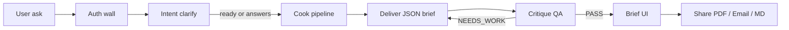
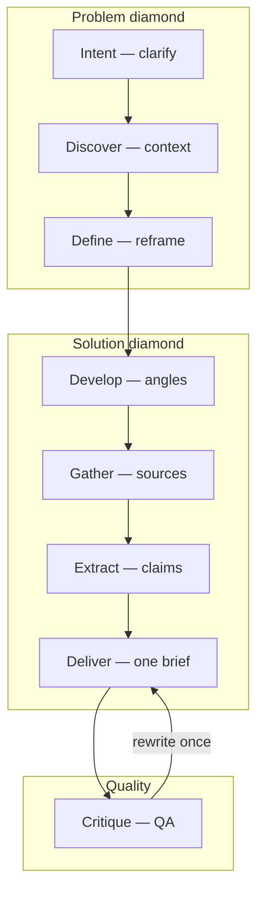
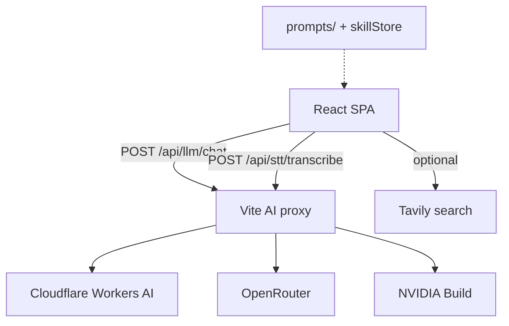

# Architecture — what each part does

AgentChicago17B turns a question into **one synthesized brief** through a staged
desk-research pipeline. The browser never talks to LLM providers directly;
local development uses a Vite proxy so API keys stay on the server.

## End-to-end flow

## Pipeline stages (skills)

| Part | Role |
|------|------|
| **AuthGate** | Blocks the SPA until access code / Cloudflare Access |
| **Intent** | Asks 1–3 clarifying questions if the ask is vague |
| **Discover → Define** | Scope and reframe the challenge |
| **Develop** | Fan out research angles |
| **Gather** | Optional Tavily (or model knowledge) |
| **Extract** | Claims, conflicts, gaps |
| **Deliver** | One Chicago-cited brief as JSON |
| **Critique** | Independent PASS / NEEDS_WORK (one rewrite) |
| **ShareBriefBar** | PDF (print), email (`mailto:`), Markdown, HTML, copy |

## Runtime components

| File / folder | Responsibility |
|---------------|----------------|
| `src/App.tsx` | Shell, history, composer, results |
| `src/components/AuthGate.tsx` | Access-code wall |
| `src/agent/pipeline.ts` | Orchestrates cook + live synthesis |
| `src/agent/intent.ts` / `critique.ts` | Clarify + QA LLM calls |
| `src/lib/shareBrief.ts` | Export / email helpers |
| `vite.config.ts` | Dev proxy for CF / OpenRouter / NVIDIA / Whisper |
| `prompts/` | Clone-and-adjust skill prompts |
| `src/admin/` | Edit prompts, test models, operators |
| `agent/` | **Eve** durable agent (Node + sandbox; models via Cloudflare AI Gateway) |
| `agent/lib/model.ts` | Cloudflare / Vercel Gateway model resolver for Eve |
| `src/eve/` | Browser client for Eve HTTP API (`/eve/v1`) |

## Brief data shape

A `ResearchBrief` holds `query`, `sources`, `angles`, `qa`, and a `synthesis`
object (`title`, `executiveSummary`, `narrative`, findings, next steps, confidence).
Share/export serializes that object — nothing leaves the browser unless the user
opens email or downloads a file.
