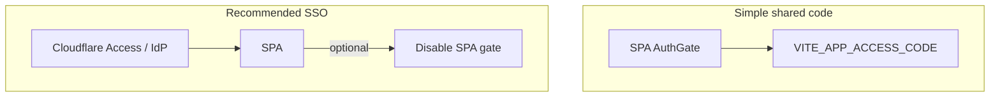

# Auth wall + sharing briefs

## Auth wall

The SPA is wrapped in `AuthGate` (`src/components/AuthGate.tsx`).

| Variable | Default | Meaning |
|----------|---------|---------|
| `VITE_AUTH_REQUIRED` | `true` | Show the access-code wall |
| `VITE_APP_ACCESS_CODE` | _(empty)_ | Shared team code required to unlock |

Session is stored in **sessionStorage** (clears when the tab closes). Use the
**Lock** control (bottom-right) to sign out early.

### Local development

1. Set `VITE_APP_ACCESS_CODE` in `.env` and restart  
2. Or click **Local only — continue without code** (dev builds only)

### Production options

- **Shared code:** keep `VITE_AUTH_REQUIRED=true` and a strong access code  
- **Cloudflare Access / SSO:** protect the hostname in Zero Trust, then set
  `VITE_AUTH_REQUIRED=false` to avoid a second login  

This is a **workspace gate**, not full multi-user identity. Operator rows in
Admin → Manage users remain local until you add a real auth backend.

## Share a brief

After a research run, **Share this brief** appears above the synthesis:

| Action | What happens |
|--------|----------------|
| **PDF** | Opens a print view — choose **Save as PDF** |
| **Email** | `mailto:` with subject + brief body (attach PDF separately for full fidelity) |
| **Markdown** | Downloads `.md` |
| **HTML** | Downloads printable `.html` |
| **Copy** | Copies Markdown to the clipboard |

Implementation: `src/lib/shareBrief.ts` + `src/components/ShareBriefBar.tsx`.
No third-party email API is required; everything stays in the browser / mail client.
