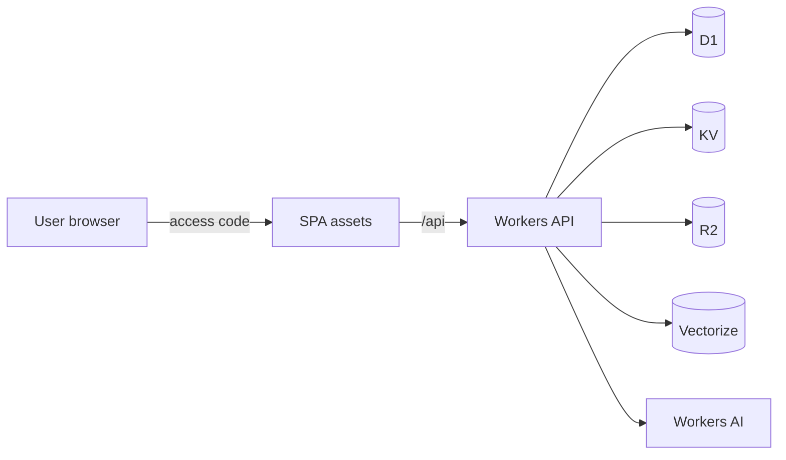

# Deploy your Chicago agent on Cloudflare

Run **your own** AgentChicago17B instance in the cloud: SPA + Worker + D1 sessions + KV cache + R2 + Vectorize RAG.

Local-only setup stays in [INSTALL.md](./INSTALL.md). CLI wizard details: [chicago-cli.md](./chicago-cli.md).

## What you get

| Piece | Role |
|-------|------|
| Worker + static assets | Desk UI + `/api/*` |
| D1 | Sessions, messages, briefs, memory |
| KV | Synthesis cache |
| R2 | Brief exports / blobs |
| Vectorize + Workers AI | RAG embeddings |
| Access code (default) | Shared unlock for your team |

**Live example:** `https://agentchicago17b.heysalad-o.workers.dev`

Eve (durable Node agent) is **optional** and does not run inside Workers — see [eve-cloudflare.md](./eve-cloudflare.md).

## Prerequisites

- Node.js 20+ (24+ if you also use Eve)  
- A [Cloudflare](https://dash.cloudflare.com) account  
- Wrangler logged in: `npx wrangler login`  
- An LLM path: Cloudflare Workers AI token (recommended), or OpenRouter / NVIDIA keys  

## Path A — Guided CLI (recommended)

From the repo root:

```bash
git clone https://github.com/Hey-Salad/AgentChicago17B.git
cd AgentChicago17B
npm install

# OpenClaw-style questions: QuickStart vs Advanced, auth, inference, CF account
npm run chicago -- onboard
```

When the wizard asks **Where will this instance run first?**, choose **Cloudflare**, then your account (e.g. HeySalad Inc.).

Then:

```bash
npm run chicago -- provision   # creates D1 / KV / R2 / Vectorize + patches wrangler.toml
npx wrangler secret put ACCESS_CODE
npx wrangler secret put CF_API_TOKEN   # or OPENROUTER_API_KEY / NVIDIA_API_KEY
npm run chicago -- deploy
npm run chicago -- doctor --url https://YOUR_WORKER.workers.dev
```

Share the Worker URL and the **ACCESS_CODE** with your users ([using-chicago.md](./using-chicago.md)).

### Non-interactive (CI)

```bash
npm run chicago -- onboard --non-interactive --accept-risk \
  --auth access-code --access-code 'your-strong-code' \
  --inference cloudflare --target cloudflare \
  --account-id YOUR_CF_ACCOUNT_ID --force

npm run chicago -- provision --account-id YOUR_CF_ACCOUNT_ID
printf '%s' 'your-strong-code' | npx wrangler secret put ACCESS_CODE
printf '%s' "$CF_API_TOKEN" | npx wrangler secret put CF_API_TOKEN
npm run chicago -- deploy
```

## Path B — Manual Wrangler

### 1. Clone and configure

```bash
cp .env.example .env
# Set VITE_AUTH_MODE=access-code
# Leave VITE_APP_ACCESS_CODE empty for cloud — Worker holds ACCESS_CODE
```

Set `account_id` in [`wrangler.toml`](../wrangler.toml).

### 2. Create bindings

```bash
export CLOUDFLARE_ACCOUNT_ID=your_account_id

npx wrangler d1 create agentchicago17b
npx wrangler kv namespace create agentchicago17b-cache
npx wrangler r2 bucket create agentchicago17b-blobs
npx wrangler vectorize create agentchicago17b-rag --dimensions=768 --metric=cosine
```

Paste `database_id` and KV `id` into `wrangler.toml`. Apply schema:

```bash
npx wrangler d1 migrations apply agentchicago17b --remote
```

### 3. Secrets

```bash
npx wrangler secret put ACCESS_CODE      # team unlock code
npx wrangler secret put CF_API_TOKEN     # Workers AI
npx wrangler secret put CF_ACCOUNT_ID    # if not using vars
# optional:
# npx wrangler secret put OPENROUTER_API_KEY
# npx wrangler secret put NVIDIA_API_KEY
```

### 4. Build and deploy

```bash
# Production SPA should NOT bake the access code into the JS bundle
VITE_AUTH_MODE=access-code VITE_AUTH_REQUIRED=true VITE_APP_ACCESS_CODE= npm run build
npx wrangler deploy
```

Unlock uses `POST /api/auth/verify` against the Worker secret.

### 5. Verify

```bash
curl https://YOUR_WORKER.workers.dev/api/health
# {"ok":true,"service":"agentchicago17b","authMode":"access-code",...}

npm run chicago -- doctor --url https://YOUR_WORKER.workers.dev
```

## Choosing auth for your instance

| Mode | When to use | Setup |
|------|-------------|--------|
| `access-code` | Small team / private demo | `wrangler secret put ACCESS_CODE` |
| `cf-access` | Company SSO | Put Cloudflare Access in front; set `AUTH_MODE=cf-access` |
| `anonymous` | Public demo | `AUTH_MODE=anonymous`; users get a device id |
| `oauth` | Multi-user product | Stub in v1 — see [auth-modes.md](./auth-modes.md) |

Set the same mode on Worker (`AUTH_MODE` in `wrangler.toml` `[vars]`) and SPA (`VITE_AUTH_MODE` at build time).

## Rotate the access code

```bash
printf '%s' 'new-strong-code' | npx wrangler secret put ACCESS_CODE
```

No redeploy required for the secret. Tell your users the new code.

## Custom domain (optional)

1. Workers & Pages → your Worker → **Triggers** → **Custom Domains**  
2. Add `research.yourdomain.com`  
3. Point users at that URL instead of `*.workers.dev`

## Troubleshooting

| Symptom | Fix |
|---------|-----|
| `error code: 1042` | Wait a minute after first deploy; confirm `workers_dev = true` |
| Unlock always fails | Confirm `ACCESS_CODE` secret; `curl -X POST .../api/auth/verify -d '{"code":"..."}'` |
| LLM errors | Set `CF_API_TOKEN` (and account) or OpenRouter/NVIDIA secrets |
| Empty sidebar sessions | Confirm D1 migrations applied `--remote` |
| Multiple CF accounts | Set `account_id` in `wrangler.toml` or `CLOUDFLARE_ACCOUNT_ID` |

## Architecture sketch



## Related

- End-user guide: [using-chicago.md](./using-chicago.md)  
- Product map: [product-map.md](./product-map.md)  
- CLI: [chicago-cli.md](./chicago-cli.md)  
- Auth adapters: [auth-modes.md](./auth-modes.md)
