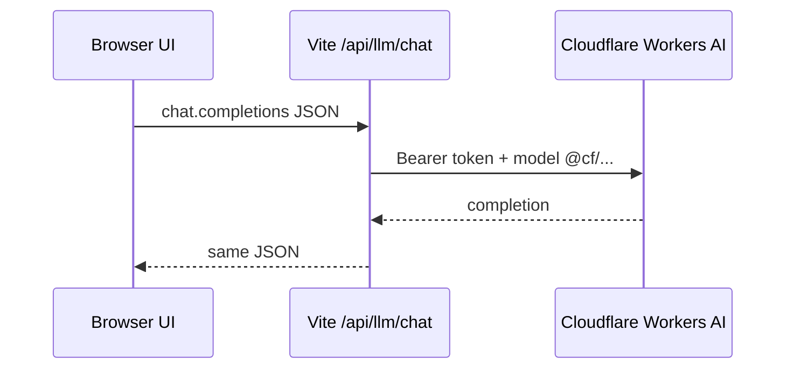

# Cloudflare setup

Use Cloudflare for **Workers AI models**, optional **Whisper** speech-to-text,
and (recommended) **Cloudflare Access** in front of a hosted UI.

## A. Workers AI as the LLM (local today)

1. In the Cloudflare dashboard, create an API token with **Workers AI** permissions.
2. Copy your **Account ID**.
3. Put in `.env`:

```env
VITE_CF_API_KEY=your_token
VITE_CF_BASE_URL=https://api.cloudflare.com/client/v4/accounts/YOUR_ACCOUNT_ID/ai/v1
VITE_LLM_MODEL=@cf/zai-org/glm-5.2
```

4. Restart `npm run dev`.
5. Pick any **CF …** model in the picker (`@cf/…` routes through the Vite proxy).



## B. Whisper (mic → text)

Uses the same `VITE_CF_*` credentials via `POST /api/stt/transcribe`.

Optional override:

```env
VITE_CF_WHISPER_MODEL=@cf/openai/whisper-large-v3-turbo
```

## C. Host the UI on Cloudflare Pages

1. Push to `Hey-Salad/AgentChicago17B`
2. Workers & Pages → Create → connect the repo  
3. Build command: `npm run build`  
4. Output directory: `dist`

Demo mode works. Live LLM needs a **Pages Function / Worker** that implements
the same `POST /api/llm/chat` contract as `vite.config.ts` and stores secrets
in the Cloudflare secret store (not `VITE_` client vars).

## D. Cloudflare Access (production auth)

1. Zero Trust → Access → Applications → add Self-hosted app for your Pages URL  
2. Policy: emails / Google / One-time PIN / IdP groups  
3. Optionally set in frontend build:

```env
VITE_AUTH_REQUIRED=false
```

so users are not double-gated (Access SSO + SPA access code).

Keep `VITE_AUTH_REQUIRED=true` + `VITE_APP_ACCESS_CODE` for simple shared-code
protection without Access.

See also [auth-and-sharing.md](./auth-and-sharing.md).
