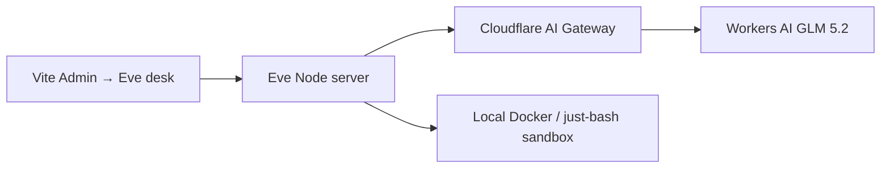

# Eve + Cloudflare AI Gateway

## What’s possible

| Layer | On Cloudflare? |
|-------|----------------|
| **LLM (GLM 5.2, etc.)** | **Yes** — Cloudflare AI Gateway / Workers AI |
| **Eve HTTP runtime** | **No native Workers deploy** — Eve is a Node/Nitro server (local or self-host) |
| **Sandbox** | Docker / microsandbox / just-bash locally (not CF Workers) |
| **Durability** | Eve’s local workflow store when self-hosting; Vercel Workflows only on Vercel |

So “Eve on Cloudflare” here means: **Eve talks to Cloudflare for models**, while the Eve process runs with Node.



## Setup

From the repo root (`AgentChicago17B/`):

```bash
npm install
```

Add to `.env` (reuse the same Cloudflare token you use for the Vite desk when possible):

```env
EVE_LLM_BACKEND=cloudflare
CF_ACCOUNT_ID=your_cloudflare_account_id
CF_API_TOKEN=your_cloudflare_api_token
CF_AIG_GATEWAY_ID=default
EVE_MODEL=@cf/zai-org/glm-5.2
```

Optional: point at the classic Unified `/compat` URL instead of the REST path:

```env
CF_AI_GATEWAY_BASE_URL=https://gateway.ai.cloudflare.com/v1/<ACCOUNT_ID>/<GATEWAY_ID>/compat
EVE_MODEL=workers-ai/@cf/zai-org/glm-5.2
```

## Run

```bash
# Terminal A — Eve (uses Cloudflare for inference)
npm run eve

# Terminal B — branded desk
npm run dev
```

Open **Admin → Eve desk** and start a session.

## Token permissions

Create an API token with **Workers AI** (and AI Gateway if you use authenticated gateways). Same style of token as `VITE_CF_API_KEY` for the classic desk.

## Switch back to Vercel AI Gateway

```env
EVE_LLM_BACKEND=vercel-gateway
AI_GATEWAY_API_KEY=vck_...
EVE_MODEL=zai/glm-5.2
```

## Self-host Eve (still using Cloudflare models)

```bash
npm run eve:build
PORT=3000 npm run eve:start
```

Put TLS / Cloudflare Access / a reverse proxy in front of that Node process if you expose it publicly. Persist Eve’s workflow data directory on the host disk.

## Why not Eve-as-a-Worker?

Eve depends on a long-running Node server, workflow storage, and a sandbox backend. Cloudflare Workers are a different runtime. Use Cloudflare for **AI Gateway + Workers AI**; keep Eve as Node (local, VM, container, or Cloudflare Containers if you operate that yourself).
