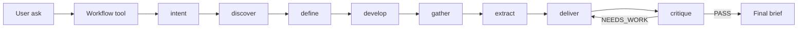

# Eve on Vercel — durable 8-step research

AgentChicago17B’s Eve agent runs the Double Diamond pipeline as **eight declared subagents**, orchestrated by Eve’s experimental **`Workflow`** tool. On Vercel, turns persist with **Vercel Workflows** and sandbox work uses **Vercel Sandbox**.

## The 8 durable steps

| # | Subagent | Role |
|---|----------|------|
| 1 | `intent` | Clarify vague asks |
| 2 | `discover` | Expand context |
| 3 | `define` | Reframe challenge |
| 4 | `develop` | Research angles |
| 5 | `gather` | Sources |
| 6 | `extract` | Claims + gaps |
| 7 | `deliver` | One brief |
| 8 | `critique` | QA (+ one rewrite) |

Files: `agent/subagents/<name>/` · orchestrator: `agent/tools/workflow.ts`



## Production

| | |
|--|--|
| **URL** | https://agentchicago17b-eve.vercel.app |
| **Project** | `hey-salad-inc/agentchicago17b-eve` |
| **Health** | `GET /eve/v1/health` → `{"ok":true,"status":"ready","workflowId":"workflow//eve//workflowEntry"}` |
| **Model** | `zai/glm-5.2` via Vercel AI Gateway |
| **Workflows** | Vercel Workflows (durable turns) |
| **Sandbox** | Vercel Sandbox (`vercel({ vcpus: 2 })`) |

## Deploy / redeploy

```bash
cd /Users/chilumbam/AgentChicago17B
# Node ≥ 24 required
source ~/.nvm/nvm.sh && nvm use 24
npm install
vercel link --yes --scope hey-salad-inc   # once
vercel deploy --prod --yes
```

Env (prod + preview):

```env
EVE_LLM_BACKEND=vercel-gateway
EVE_MODEL=zai/glm-5.2
# AI_GATEWAY_API_KEY optional if project OIDC is linked
```

Verify:

```bash
curl https://agentchicago17b-eve.vercel.app/eve/v1/health
```

## Local vs Vercel

| | Local `npm run eve` | Vercel `eve deploy` |
|--|---------------------|---------------------|
| Durability | Local workflow store | **Vercel Workflows** |
| Sandbox | Docker / just-bash | **Vercel Sandbox** |
| Model default | Cloudflare AI Gateway | **Vercel AI Gateway** (`zai/glm-5.2`) |
