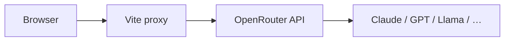

# OpenRouter setup

[OpenRouter](https://openrouter.ai/) is an OpenAI-compatible router. One key can
reach many models (Claude, GPT, Llama, …). AgentChicago17B talks to it through
the same Vite proxy as Cloudflare / NVIDIA.

## 1. Create a key

1. Sign in at [openrouter.ai](https://openrouter.ai/)
2. Create a key at [openrouter.ai/keys](https://openrouter.ai/keys)
3. Add credits if you use paid models

## 2. Configure `.env`

```env
VITE_OPENROUTER_API_KEY=sk-or-v1-...
VITE_OPENROUTER_BASE_URL=https://openrouter.ai/api/v1
VITE_LLM_PROVIDER=openrouter
VITE_LLM_MODEL=anthropic/claude-sonnet-4
VITE_APP_URL=http://127.0.0.1:5173
VITE_APP_NAME=AgentChicago17B
```

`VITE_APP_URL` / `VITE_APP_NAME` are sent as OpenRouter `HTTP-Referer` / `X-Title`
headers (ranking + attribution).

Restart `npm run dev` after edits.

## 3. Pick a model

In the UI model picker, use the **OpenRouter** group, or set `VITE_LLM_MODEL` to
any OpenRouter slug, for example:

| Slug | Notes |
|------|--------|
| `openrouter/auto` | Router chooses |
| `anthropic/claude-sonnet-4` | Strong briefs |
| `openai/gpt-4.1-mini` | Fast JSON |
| `meta-llama/llama-3.3-70b-instruct` | Open-weight |



## 4. Production

Mirror the Vite proxy on your host:

`POST /api/llm/chat` → `https://openrouter.ai/api/v1/chat/completions`

Store `OPENROUTER_API_KEY` as a **server secret**. Do not bake it into the
frontend bundle.

## Tip: Cloudflare + OpenRouter together

You can configure both. `@cf/…` models use Cloudflare credentials; OpenRouter
slugs use `VITE_OPENROUTER_API_KEY`. Switch per request in the model picker.
