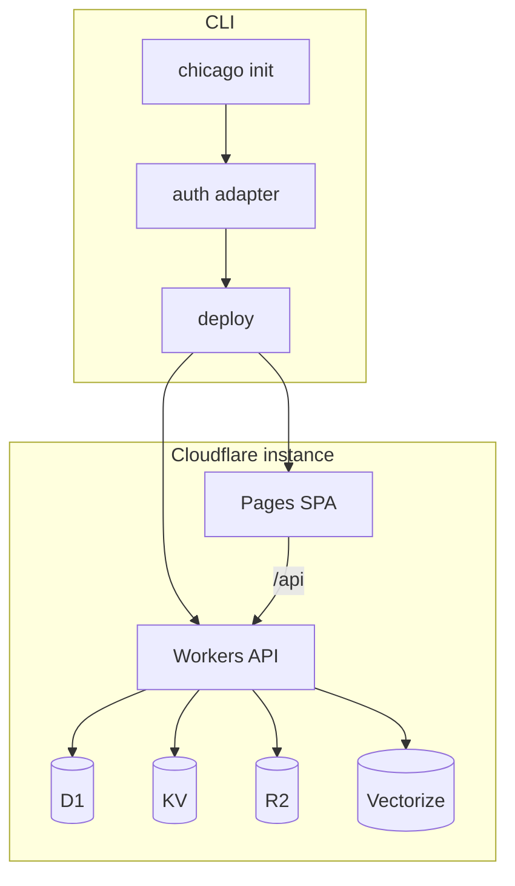

# Product map — deployable research agent

AgentChicago17B is shipping as a **deployable research-agent instance**, not only a hosted SPA.

| Layer | Role |
|-------|------|
| **Desk SPA** | Vite/React research UI (classic double-diamond cook) |
| **Cloudflare data plane** | Pages/Worker assets + D1 sessions/chats, KV cache, R2 blobs, Vectorize RAG |
| **Auth adapters** | Deploy-time choice: access-code · cf-access · oauth · anonymous |
| **CLI** | `chicago init` → configure → deploy → doctor |
| **Eve (optional)** | Durable Node agent on Vercel/local — not a Worker in v1 |



## Auth

Operators pick one mode at init/deploy. See [auth-modes.md](./auth-modes.md).

Default template: **`access-code`**.

## Persistence

| Store | Use |
|-------|-----|
| **D1** | workspaces, users, sessions, messages, briefs metadata, memory_items, share_links |
| **KV** | synthesis cache, session list snapshots, rate limits |
| **R2** | brief exports, uploaded sources |
| **Vectorize** | RAG over sources + saved briefs |

## Inference

Classic desk still proxies LLM calls (`/api/llm/chat`) to Cloudflare Workers AI, OpenRouter, or NVIDIA. Eve inference is separate ([eve-inference-providers.md](./eve-inference-providers.md)).

## CLI

```bash
npx chicago init
npx chicago configure
npx chicago deploy
npx chicago doctor
```

In-repo package: [`packages/cli`](../packages/cli). Guided questions: [chicago-cli.md](./chicago-cli.md).

## Non-goals (v1)

- Eve inside Workers
- Multi-tenant billing
- Replacing Eve Workflows with Durable Objects for the 8-step agent

## Related

- [auth-modes.md](./auth-modes.md)
- [eve-integration.md](./eve-integration.md)
- [architecture.md](./architecture.md)
